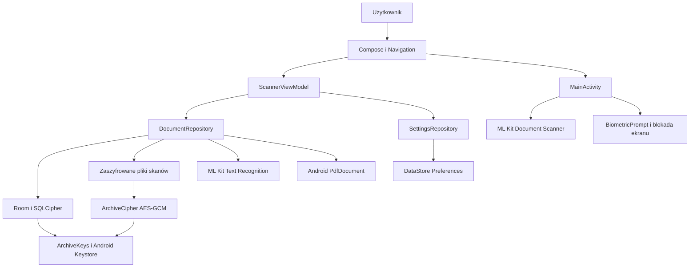
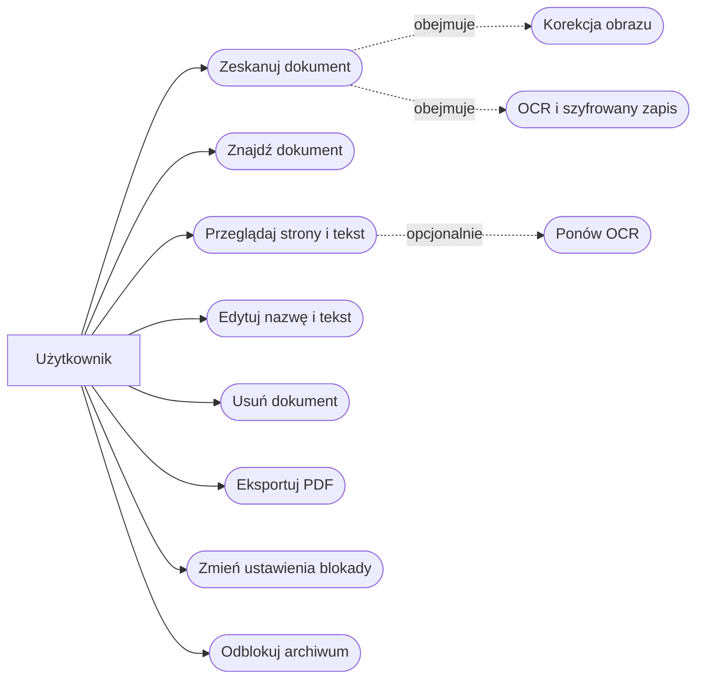
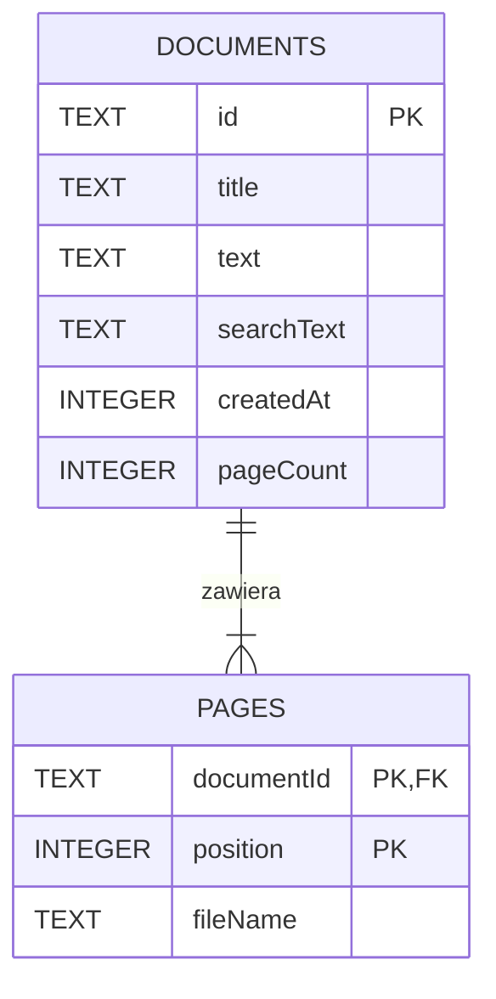
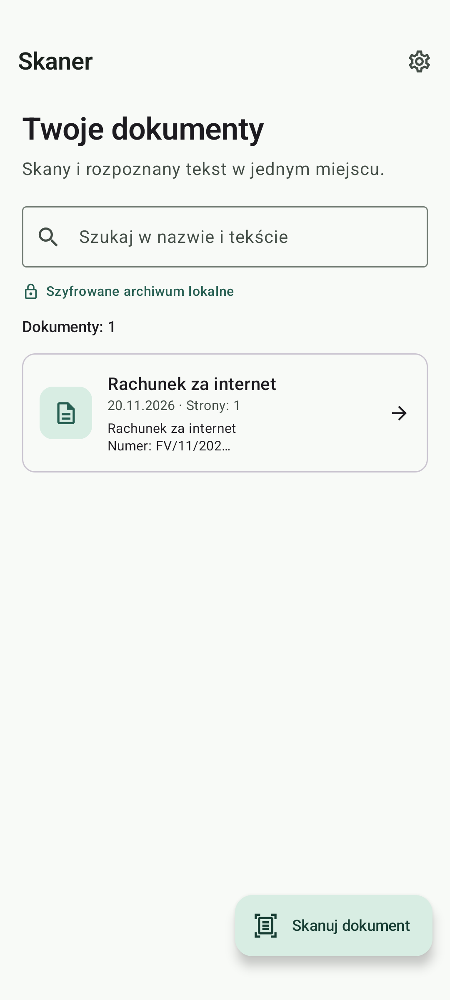
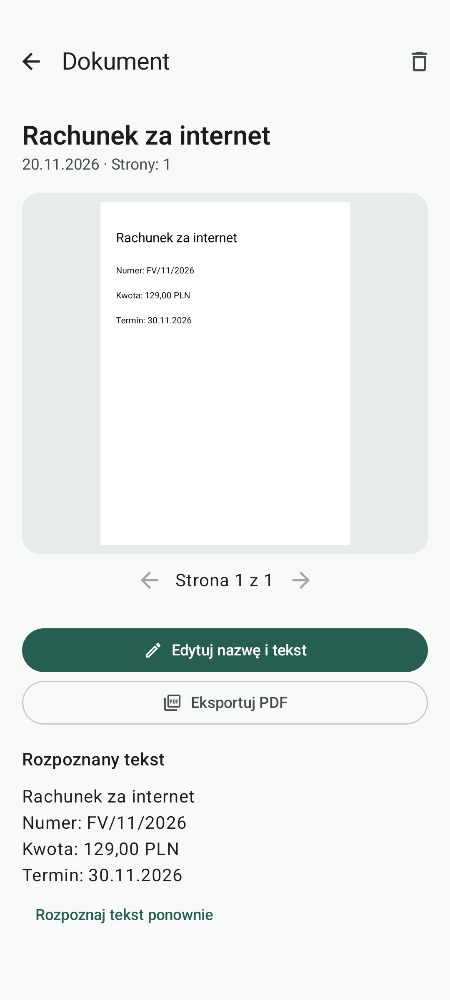
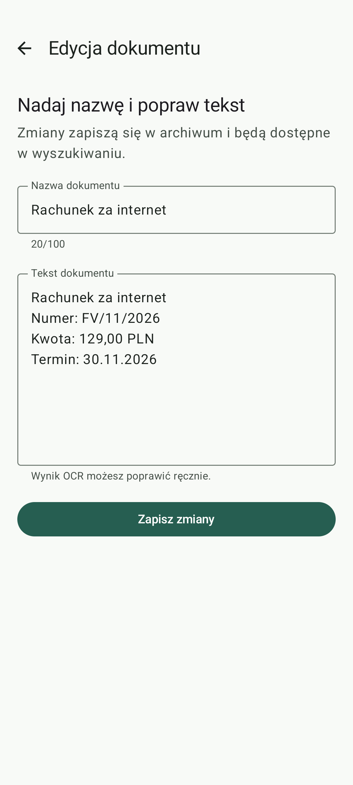
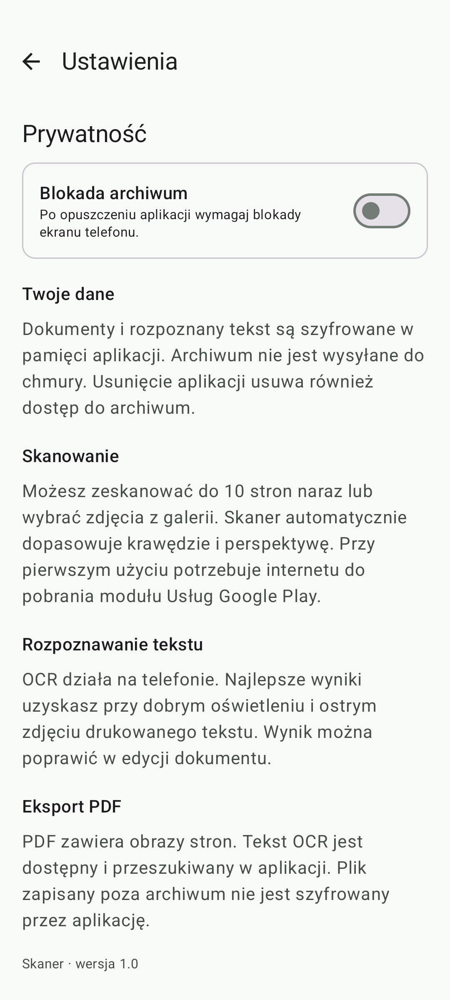

# Skaner dokumentów z OCR

## Cel i zakres

Celem aplikacji jest wykonanie cyfrowej kopii papierowego dokumentu, odczytanie jego tekstu i łatwe odnalezienie go w lokalnym archiwum. Użytkownik pracuje w czterech głównych widokach: archiwum, szczegóły dokumentu, edycja oraz ustawienia. Fotografowanie i korekcję obrazu realizuje dodatkowy interfejs skanera ML Kit.

Zakres obejmuje dokumenty do 10 stron, OCR drukowanego tekstu alfabetu łacińskiego, CRUD, wyszukiwanie, PDF oraz ochronę lokalnych danych. Aplikacja nie wymaga konta, własnego serwera ani klucza płatnego API.

## Wymagania funkcjonalne

| ID | Wymaganie | Realizacja |
|---|---|---|
| F01 | Wykonywanie zdjęć | Skaner ML Kit z aparatem oraz importem zdjęć z galerii |
| F02 | Wykrywanie krawędzi i korekcja perspektywy | Automatyczna analiza w ML Kit oraz możliwość ręcznej korekty kadru |
| F03 | Rozpoznawanie tekstu | Lokalny model ML Kit Text Recognition, uruchamiany po skanowaniu |
| F04 | Dodawanie danych | Zapis dokumentu i jego stron w jednej transakcji bazy |
| F05 | Odczyt danych | Lista archiwum, podgląd stron i rozpoznanego tekstu |
| F06 | Edycja danych | Zmiana nazwy i tekstu OCR |
| F07 | Usuwanie danych | Potwierdzenie, usunięcie rekordu i zaszyfrowanych skanów |
| F08 | Walidacja | Niepusta nazwa do 100 znaków, tekst do 200 000 znaków, do 10 stron, zdjęcie do 30 MB |
| F09 | Wyszukiwanie | Nazwa i tekst OCR; normalizacja wielkości liter oraz polskich znaków |
| F10 | Trwałość | Room z SQLCipher i pliki w prywatnym katalogu aplikacji |
| F11 | Eksport PDF | Wielostronicowy PDF z obrazami; miejsce zapisu wybiera użytkownik |
| F12 | Ochrona danych | AES-GCM, SQLCipher, Android Keystore, opcjonalne uwierzytelnienie systemowe |
| F13 | Nawigacja i stan | Navigation Compose, ViewModel, SavedStateHandle i rememberSaveable |
| F14 | Obsługa błędów | Komunikaty, ponawianie odczytu archiwum i OCR; zachowanie skanów przy błędzie OCR |

## Wymagania niefunkcjonalne

| Obszar | Rozwiązanie |
|---|---|
| Responsywność | Przewijane widoki Compose, elastyczna szerokość, skalowanie obrazów |
| Material Design 3 | Standardowe pola, karty, przyciski, dialogi i pasek aplikacji |
| Dostępność | Opisy przycisków ikonowych, tekstowe etykiety, semantyka przełącznika, kontrastowe kolory |
| Wydajność | Operacje plikowe, baza, PDF i przetwarzanie obrazów poza głównym wątkiem; ograniczanie rozdzielczości |
| Zmiana konfiguracji | ViewModel zachowuje zadania, SavedStateHandle zapytanie i eksport, rememberSaveable edycję i numer strony |
| Modułowość | Oddzielone pakiety `ui`, `data`, `domain` i `security` |
| Rozbudowa | Repozytorium stanowi miejsce dodania kategorii, nowych sposobów importu lub synchronizacji |
| Bezpieczeństwo | Prywatne pliki, szyfrowanie, brak kopii zapasowych, brak logowania treści dokumentów |

## Architektura MVVM

Widoki wyświetlają stan i przekazują działania do ViewModel. ViewModel koordynuje pracę, udostępnia StateFlow i emituje zdarzenia nawigacyjne lub komunikaty. Repozytorium wykonuje operacje na dokumentach. DAO zawiera zapytania SQL, a klasy bezpieczeństwa zajmują się szyfrowaniem i kluczami. Mały `AppContainer` jawnie tworzy zależności; dodatkowy framework wstrzykiwania zależności nie jest potrzebny.

## Przypadki użycia

Skanowanie: użytkownik otwiera skaner, fotografuje lub importuje strony, sprawdza kadr i zatwierdza wynik. Aplikacja szyfruje obrazy, uruchamia OCR i zapisuje komplet dokumentu w bazie. Następnie otwiera edycję nazwy i tekstu. Jeśli OCR zawiedzie, skany pozostają zapisane, a użytkownik otrzymuje komunikat i może ponowić rozpoznawanie.

Eksport: użytkownik wybiera eksport w szczegółach, otrzymuje informację o braku szyfrowania pliku poza archiwum i wskazuje miejsce zapisu. PDF jest tworzony ze skanów bez pośredniego jawnego pliku w katalogu aplikacji.

## Model bazy danych

Dokument ma identyfikator UUID i od 1 do 10 stron. Klucz strony jest złożony z identyfikatora dokumentu i pozycji. Klucz obcy ma `ON DELETE CASCADE`. Pole `searchText` zawiera znormalizowaną nazwę i tekst; pozostaje wewnątrz szyfrowanej bazy. Nazwa pliku jest generowana przez aplikację i walidowana przed odczytem.

Zapis rekordów dokumentu i stron jest transakcyjny. Jeśli zapis się nie powiedzie, nowo utworzone pliki są usuwane. Przy uruchamianiu repozytorium usuwa osierocone pliki pozostałe po przerwaniu procesu. Zmiana schematu w przyszłości wymaga migracji Room; aplikacja nie usuwa bazy automatycznie przy błędzie.

## Bezpieczeństwo

- SQLCipher szyfruje bazę z nazwami dokumentów, tekstem OCR i indeksem wyszukiwania.
- Każdy skan jest szyfrowany AES-256-GCM z nowym wektorem inicjalizacyjnym. Znacznik uwierzytelniający pozwala wykryć modyfikację pliku.
- Losowe hasło bazy jest przechowywane w zaszyfrowanym pliku w `noBackupFilesDir`. Klucz opakowujący jest przechowywany w Android Keystore.
- Aplikacja nie zapisuje jawnych miniatur. Podgląd jest odszyfrowywany do pamięci.
- Opcjonalna blokada używa systemowego BiometricPrompt lub danych blokady ekranu. Po opuszczeniu aplikacji archiwum zostaje ponownie zablokowane.
- Kopie zapasowe i transfer danych archiwum są wyłączone, ponieważ klucz Keystore jest związany z instalacją i urządzeniem.
- Kompilacja release blokuje zrzuty ekranu przez `FLAG_SECURE`. Debug pozwala przygotować dokumentację.

Interfejs skanera i jego pliki tymczasowe są zarządzane przez SDK Google. Gwarancja szyfrowania dotyczy własnego archiwum aplikacji po imporcie. PDF wyeksportowany przez użytkownika jest jawnym plikiem. Blokada interfejsu jest dodatkową kontrolą dostępu; klucz szyfrujący nie jest kryptograficznie powiązany z każdorazowym uwierzytelnieniem biometrycznym.

## Technologie i biblioteki

| Technologia | Zastosowanie |
|---|---|
| Kotlin i Android SDK 36 | Kod aplikacji i API platformy |
| Compose Material 3 | Interfejs |
| Navigation Compose | Przejścia między czterema ekranami |
| ViewModel i Lifecycle | Stan ekranu i cykl życia |
| Coroutines, Flow, Tasks await | Operacje asynchroniczne i obserwowanie archiwum |
| Room, KSP, SQLCipher | Typowane zapytania i szyfrowana baza SQLite |
| ML Kit Document Scanner | Aparat, kadrowanie i perspektywa |
| ML Kit Text Recognition | Lokalny OCR |
| DataStore | Ustawienie blokady |
| Android Keystore i javax.crypto | Ochrona kluczy i szyfrowanie plików |
| BiometricPrompt | Uwierzytelnienie urządzeniem |
| PdfDocument i Storage Access Framework | PDF i wybór miejsca zapisu |
| JUnit i Compose UI Test | Testy jednostkowe, integracyjne i interfejsu |

Dokładne wersje są przypięte w `build.gradle.kts` i `app/build.gradle.kts`. Zastosowano gotowy skaner ML Kit, aby ograniczyć ilość kodu i uprościć obsługę. OpenCV i CameraX nie są zależnościami tej implementacji. Własna komunikacja REST nie jest potrzebna dla lokalnego archiwum; pierwsze pobranie modułu skanera realizują Usługi Google Play.

## Zrzuty ekranów

Widoki są wykonywane na emulatorze z fikcyjnym rachunkiem; nie zawierają danych osobowych.

| Archiwum | Szczegóły |
|---|---|
|  |  |

| Edycja | Ustawienia |
|---|---|
|  |  |

## Instalacja i weryfikacja

Instrukcję budowania i instalacji zawiera główny README. Wyniki kontroli i scenariusze sprawdzenia na Motoroli razr 50 ultra są w `TESTY.md`. Do oddania należy dołączyć APK, niniejszą dokumentację i wyniki testów. Repozytorium: [ehoze/ZPNPA_Projekt](https://github.com/ehoze/ZPNPA_Projekt).

## Ograniczenia i dalszy rozwój

OCR zależy od ostrości, światła i jakości wydruku; wynik można poprawić ręcznie. Dokumenty pisane odręcznie nie są zakładanym zastosowaniem. PDF zawiera obrazy stron, bez niewidocznej warstwy tekstowej. Limit 10 stron ogranicza zużycie pamięci. Eksport nie obejmuje zaszyfrowanej kopii zapasowej archiwum.

Możliwa rozbudowa obejmuje kategorie, sortowanie, dodawanie stron do istniejącego dokumentu, powiększanie podglądu i PDF z warstwą tekstową. Funkcje te nie są potrzebne do podstawowego zakresu projektu.

## Źródła techniczne

- [ML Kit Document Scanner](https://developers.google.com/ml-kit/vision/doc-scanner/android)
- [ML Kit Text Recognition](https://developers.google.com/ml-kit/vision/text-recognition/v2/android)
- [Room](https://developer.android.com/training/data-storage/room)
- [SQLCipher for Android](https://github.com/sqlcipher/sqlcipher-android)
- [Android Keystore](https://developer.android.com/privacy-and-security/keystore)
- [Zalecenia architektury Android](https://developer.android.com/topic/architecture)
